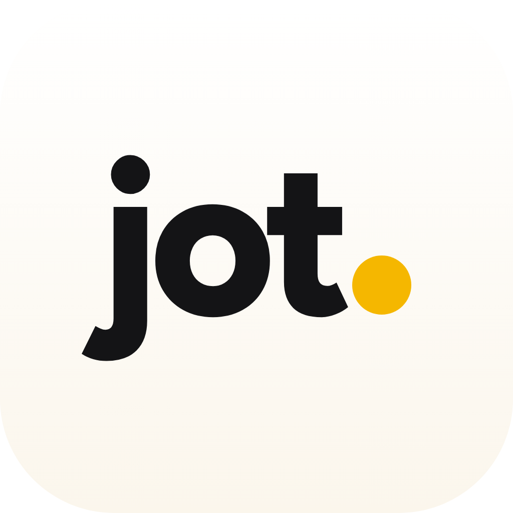
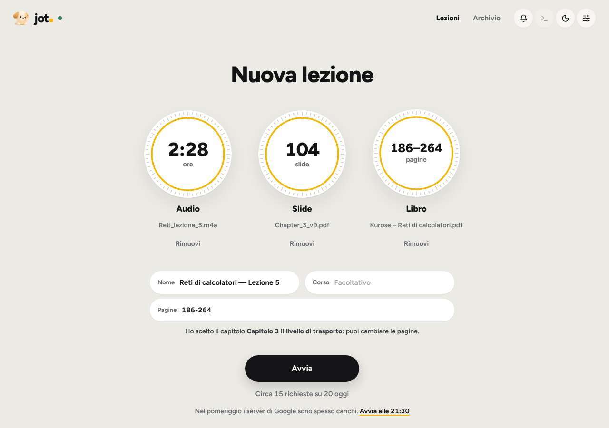
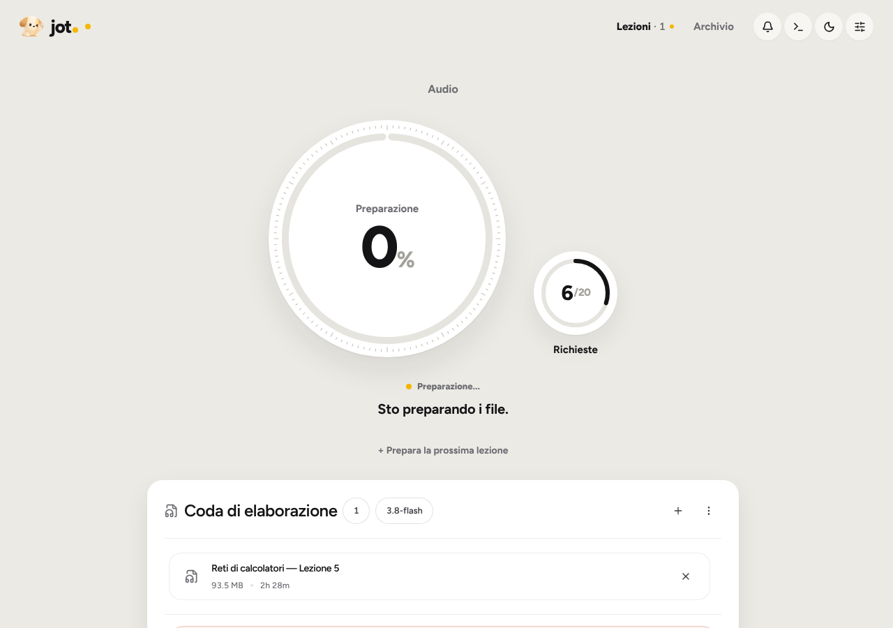
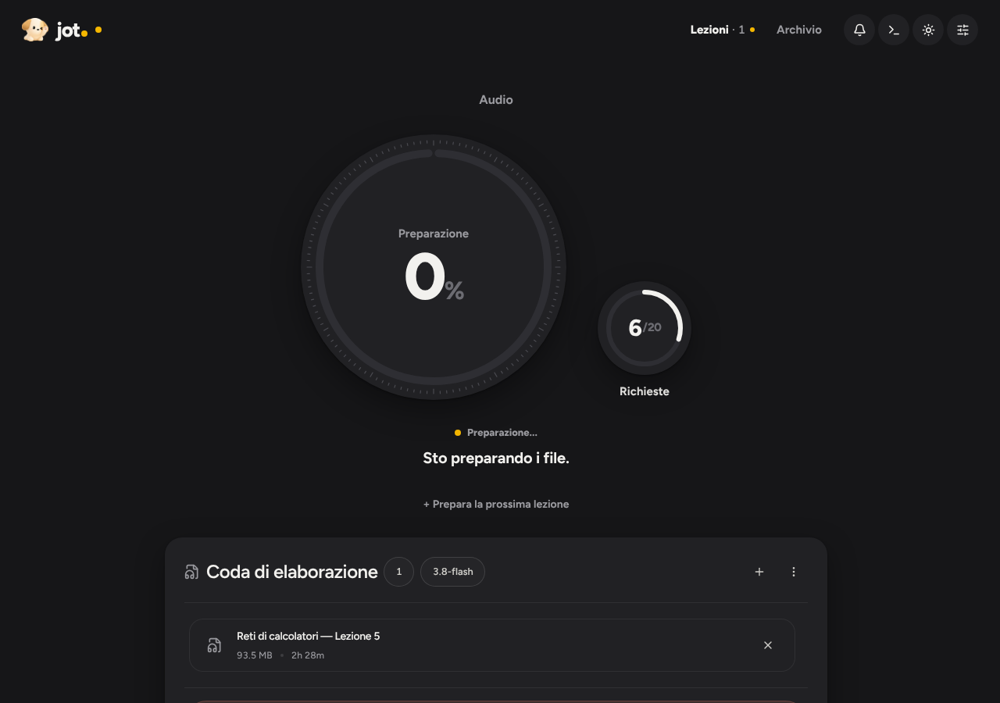
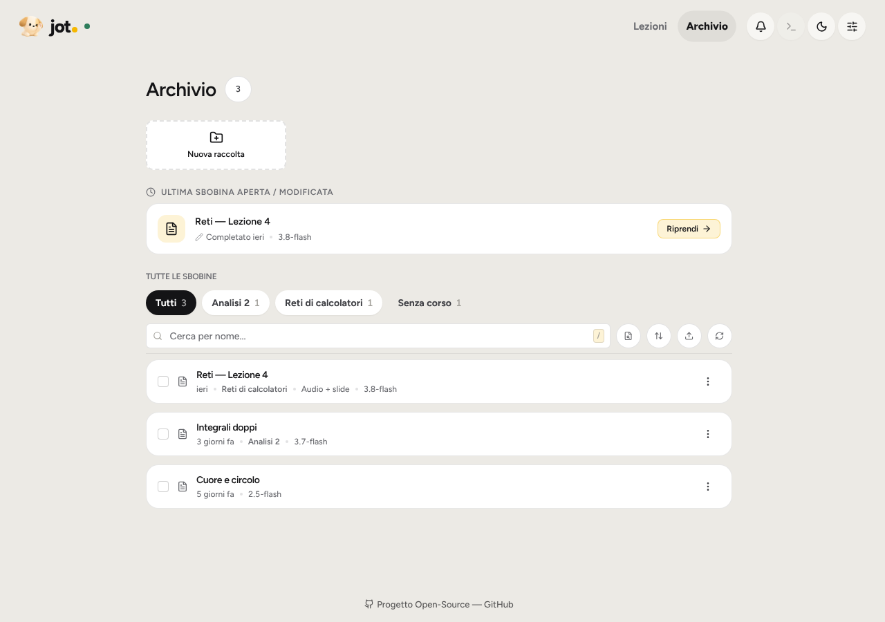

<p align="center">
  
</p>

<h1 align="center">jot.</h1>

<p align="center">
  Le tue lezioni diventano appunti. Audio, slide e libro in un'unica pagina, con Google Gemini.
</p>

<p align="center">
  <a href="https://github.com/antonuccilorenzogit/Jot/releases/latest"></a>
  
  <a href="LICENSE"></a>
</p>

<p align="center">
  
</p>

---

## Cosa fa

- **Una pagina, tre fonti.** Aggiungi l'**audio** della lezione, le **slide** (PDF o PowerPoint) e il **libro** (PDF), nella combinazione che vuoi:
  - solo audio: la lezione trascritta e riordinata in appunti di studio;
  - audio + slide: le slide correggono termini, sigle e formule e chiariscono i concetti importanti; quelle che il docente non spiega vengono ignorate;
  - audio + libro: in revisione il libro chiarisce i passaggi difficili, con una o due frasi nel punto giusto;
  - solo slide (+ libro): appunti completi dalle slide.

  Slide e libro **non aggiungono richieste**: una lezione di 2 ore e mezza costa circa 15 richieste su 20 gratuite al giorno.
- **Pensa da solo ai dettagli.** Nome della lezione e capitolo del libro vengono suggeriti dai file; prima di partire vedi quante richieste servono e quante ne restano oggi; se la quota finisce, riparte da sola dopo il reset; nelle ore di punta propone di partire più tardi.
- **Ti fa vedere cosa succede.** Un quadrante mostra il blocco in corso e una frase spiega il passaggio: «Ascolto i minuti 43–58 e scrivo gli appunti».
- **Appunti da studiare.** Editor con audio sincronizzato: ogni sezione ha il minuto della lezione, un clic e l'audio salta lì. Formule vere (LaTeX), **Esporta PDF** pulito, copia per Google Docs e Word.
- **Archivio per corso.** Lezioni raggruppate per corso, raccolte e ricerca nel testo.
- **I tuoi dati restano tuoi.** Nessun server intermedio: l'app parla direttamente con Google Gemini usando la **tua** chiave gratuita.

<p align="center">
  
  
</p>
<p align="center">
  
  
</p>

---

## Download

| Sistema | Pacchetto | Installazione |
| :--- | :--- | :--- |
| **Windows** | [**jot-Setup.exe**](https://github.com/antonuccilorenzogit/Jot/releases/latest) | Avvia l'installer: si installa e si apre da solo. |
| **macOS** | [**jot.dmg**](https://github.com/antonuccilorenzogit/Jot/releases/latest) | Apri il `.dmg` e trascina *jot* in **Applicazioni**. |

All'avvio jot controlla se c'è una versione nuova e la installa con un clic.

---

## Primi passi

1. **Prendi una chiave gratuita** su [aistudio.google.com/apikey](https://aistudio.google.com/apikey) (*Create API key*).
2. **Incollala in jot** al primo avvio: l'app sceglie da sola il modello Gemini migliore per la tua chiave e i modelli di riserva. La chiave resta nel portachiavi del sistema (Windows DPAPI o macOS Keychain).
3. **Nuova lezione:** clicca i quadranti **Audio**, **Slide** e/o **Libro**, controlla nome, corso e pagine, poi **Avvia**.
4. **Studia:** la lezione si apre nell'editor con l'audio; clicca il minuto di una sezione per riascoltarla, **Esporta PDF** quando vuoi stamparla.

Formati audio e video: `.m4a` `.mp3` `.wav` `.aac` `.flac` `.ogg` `.opus` `.mp4` `.mkv` `.webm` `.mov` `.3gp`. Slide: `.pdf` `.pptx`. Libro: `.pdf` (fino a 300 pagine selezionate).

> [!NOTE]
> **Quote Google.** Ogni utente usa la propria chiave e il proprio progetto Google: quote, modelli disponibili ed eventuali costi dipendono dal tuo piano ([Termini Gemini API](https://ai.google.dev/gemini-api/terms)). Le quote giornaliere si azzerano alle 00:00 ora del Pacifico (le 09:00 in Italia).

---

## Risoluzione Problemi Comuni

### Avviso SmartScreen su Windows ("PC protetto da Windows")
Nei software open source distribuiti senza certificato commerciale a pagamento, Windows può mostrare questo avviso al primo avvio:
1. Nella schermata blu, cliccare su **Ulteriori informazioni**.
2. Cliccare sul pulsante **Esegui comunque**.

### Schermata bianca o vuota all'avvio su Windows 10
Se la finestra resta vuota all'avvio su Windows 10, è necessario installare il componente ufficiale Microsoft gratuito: [WebView2 Runtime](https://go.microsoft.com/fwlink/p/?LinkId=2124703) *(già incluso di serie in Windows 11).*

### Avviso sviluppatore non verificato su macOS (Gatekeeper)
Poiché l'applicazione è open source e distribuita senza certificato a pagamento Apple Developer, macOS potrebbe bloccarne l'avvio o mostrare l'avviso *"L'applicazione è danneggiata e non può essere aperta"*:

- **Metodo standard (macOS Ventura, Sonoma, Sequoia)**:
  1. Aprire **Impostazioni di Sistema** → **Privacy e Sicurezza**.
  2. Scorrere in basso fino alla sezione **Sicurezza**.
  3. In corrispondenza dell'avviso di blocco per *jot*, cliccare su **Apri comunque** e confermare con la propria password o Touch ID.
- **Se macOS mostra "App danneggiata" (rimozione quarantena)**:
  Se il file scaricato dal browser viene contrassegnato con questo messaggio, aprire il **Terminale** ed eseguire il seguente comando:
  ```bash
  xattr -cr "/Applications/jot.app"
  ```
- **Metodo rapido alternativo (versioni precedenti)**:
  Nella cartella **Applicazioni**, fare clic destro (o `Control` + clic) su *jot* e selezionare **Apri**, quindi confermare nella finestra di dialogo.

---

## Privacy

jot gira sul tuo computer e non ha un backend: audio, appunti e chiave restano in locale e i contenuti da elaborare vanno direttamente a Google Gemini (`generativelanguage.googleapis.com`). Termini completi in [DISCLAIMER.md](DISCLAIMER.md).

---

## Per sviluppatori

- [CONTRIBUTING.md](CONTRIBUTING.md): ambiente locale, linter e test (`pytest`, `vitest`).
- [docs/architecture.md](docs/architecture.md), [docs/pipeline.md](docs/pipeline.md), [docs/lezione_unica.md](docs/lezione_unica.md).
- Per avviare dal codice su Windows installa `requirements/requirements.lock` (le stesse versioni della build).
- **Nuova versione:** aggiorna il numero in [`VERSION`](VERSION) e fai push su `main`: GitHub Actions compila gli installer e pubblica la release `vX.Y.Z`.

---

## Licenza

[MIT](LICENSE). jot contiene codice di terze parti con le rispettive licenze: vedi [THIRD_PARTY_NOTICES.md](THIRD_PARTY_NOTICES.md).
